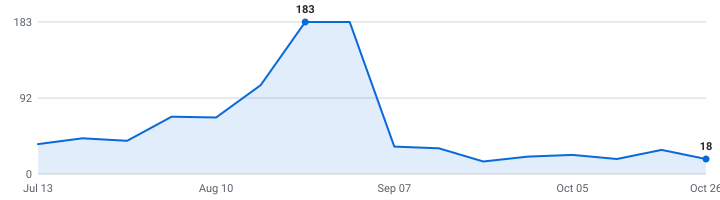

# 🎓 Summer 2027 Tech Internships — Singapore & Southeast Asia

**A self-updating engine that tracks tech internships so you don't have to.**

&nbsp;&nbsp;&nbsp;

### 132 open roles (97 listed below) · 29 new this week

4,401 employers tracked · data as of Oct 21, 2026 at 23:30 UTC

_31 have a cycle the employer stated · 101 are recent postings whose cycle isn't stated (listed separately, never mixed in)._

**[🖥️ Live dashboard](https://crunchybiscuit19.github.io/Automated-List-Of-Summer-2027-and-Fall-2026-Tech-Internships/)** · **[📡 RSS](https://crunchybiscuit19.github.io/Automated-List-Of-Summer-2027-and-Fall-2026-Tech-Internships/feed.xml)** · **[⚙️ JSON API](https://crunchybiscuit19.github.io/Automated-List-Of-Summer-2027-and-Fall-2026-Tech-Internships/api/jobs.json)** · **[✉️ Email alerts](https://crunchybiscuit19.github.io/Automated-List-Of-Summer-2027-and-Fall-2026-Tech-Internships/#subscribe)**

> [!TIP]
> **⭐ Star this repo** to save it and get updates when new roles are added.

Instead of refreshing a dozen career pages by hand, it reads company hiring feeds directly and keeps one live list — newest roles on top, refreshed automatically throughout the day.

**🔔 New roles in your inbox:** [subscribe by email](https://crunchybiscuit19.github.io/Automated-List-Of-Summer-2027-and-Fall-2026-Tech-Internships/#subscribe) - one email a day, only when new internships actually appeared, unsubscribe from any email in two clicks. (Prefer RSS-to-email? [Feedrabbit works too](https://feedrabbit.com/subscriptions/new?url=https%3A%2F%2Fraw.githubusercontent.com%2FCrunchyBiscuit19%2FAutomated-List-Of-Summer-2027-and-Fall-2026-Tech-Internships%2Fmain%2Fdocs%2Ffeed.xml).)

---

## What this is

This is an engine, not a hand-kept list. It polls company career feeds every 30 minutes, finds the internships, removes duplicates, and rebuilds this page on its own.

Every link comes straight from the source — so it's real and current, not a stale list someone forgot to update. Speed matters.

## What makes this different

| | |
|---|---|
| 🌏 **Built for Singapore & Southeast Asia** | Every role is filtered to the region above, from the posting's own location. Country-prefixed and city-only postings are both understood, so a bare "Kuala Lumpur" or "SG-Singapore" is never missed. |
| 📆 **A real date on nearly every role** | Taken from the job portal itself wherever the portal states one, so newest-first actually means newest. The exact coverage figure is printed at the bottom of this page every run. |
| 🧰 **Skill tags + pay, extracted** | Every posting's text is scanned for the stack it wants (Python, C++, PyTorch, …) and the pay it states — searchable on the [dashboard](https://crunchybiscuit19.github.io/Automated-List-Of-Summer-2027-and-Fall-2026-Tech-Internships/), and included in the CSV and API. |
| 🔔 **Alerts your way** | [Email digests](https://crunchybiscuit19.github.io/Automated-List-Of-Summer-2027-and-Fall-2026-Tech-Internships/#subscribe) or [RSS](https://crunchybiscuit19.github.io/Automated-List-Of-Summer-2027-and-Fall-2026-Tech-Internships/feed.xml) — point any reader, or a Slack/Discord RSS integration, at it. Plus a [live dashboard](https://crunchybiscuit19.github.io/Automated-List-Of-Summer-2027-and-Fall-2026-Tech-Internships/) with search, filters, and a saved-roles list that never leaves your browser. |
| ⚙️ **An engine, not a spreadsheet** | 4,651 job-board endpoints (4,401 distinct employers; some run more than one board) polled every 30 minutes across 12 ATS platforms. Full source and tests in this repo. |

## Scope

| | |
|---|---|
| **Roles** | Software Engineering, Data Science & Machine Learning (and closely related technical internships) |
| **Region** | Singapore & Southeast Asia |
| **Cycles** | Summer 2027 and Fall 2026 |

## About

I built this for the search I'm doing myself, so it tracks Singapore & Southeast Asia — that's where I'm applying. Everything is filtered from each posting's own stated location, and the same engine can be pointed at another region by editing one line of [`data/config.json`](data/config.json).

Use it to spot roles early and apply before they fill up. Being first genuinely helps.

## Where this is going

I'm building this in the open and adding to it as it grows.

**Recently shipped:** email alerts · the live dashboard · Singapore & Southeast Asia coverage

**Next up:** personalized alerts (pick your categories) · per-company hiring pages · a ghost-posting detector

If it helps you, a star means a lot and tells me to keep going.

## How to use

<b>Reading the table — flags, dates, and the cycle split</b> (click to expand)

- Roles are grouped by cycle below - **newest posting on top, oldest at the bottom.**
- A cycle section holds only roles whose **employer stated that cycle** - in the title, or in the posting's own text. Postings that name no cycle anywhere are in *Recently posted — cycle not stated* further down, with **no cycle guessed for them**. Same quality bar, different amount of evidence.
- The **Posted** column is the date the company published the role.
- **_(3 openings)_ after a role title** = the employer has that many separate live requisitions for the same job, in the same place, for the same cycle. They're all real and each takes its own application, so they're linked individually (**Apply**, then **#2**, **#3**) instead of repeating the row. Counts still count requisitions, and the CSV export is never grouped.
- **🆁 after a company name** = **this role is remote** — the posting's own location or title says so. It marks the role on that row, not the whole company.
- **🆕 after a role title** = spotted in the last 48 hours.
- **Work passes:** most roles here are open to students studying in the country concerned; in Singapore a non-resident intern normally needs a Work Holiday Pass or a Training Employment Pass, which the employer applies for. Postings rarely say either way, so confirm before you count on it.
- Track your applications with [`data/internships.csv`](data/internships.csv) (opens in Excel / Google Sheets).
- Missing a company? Adding one takes a single line, see [CONTRIBUTING.md](CONTRIBUTING.md).

---

## Summer 2027  (20 employer-stated)

| Company | Role | Category | Location | Skills | Posted | Apply |
|---|---|---|---|---|---|---|
| Citi | Technology- Cyber Security, Summer Analyst (Internship), Philippines 2027 | Security | Taguig  Philippines | Java, TypeScript, LLMs, React | Oct 19, 2026 | [Apply](https://citi.wd5.myworkdayjobs.com/2/job/Taguig--Philippines/Technology--Cyber-Security--Summer-Analyst--Internship---Philippines-2027_261002901) |
| Parexel | Clinical Data Analyst Intern 2027 | Data & ML/AI | Malaysia-Petaling Jaya | GCP | Oct 19, 2026 | [Apply](https://wd1.myworkdaysite.com/recruiting/parexel/Parexel_External_Careers/job/Malaysia-Petaling-Jaya/Clinical-Data-Analyst-Intern-2027_R0000047177) |
| Citi | Technology - Infrastructure, Summer Analyst (Internship), Philippines, 2027 | Software | Taguig  Philippines | Java, TypeScript, LLMs, React | Oct 19, 2026 | [Apply](https://citi.wd5.myworkdayjobs.com/2/job/Taguig--Philippines/Technology---Infrastructure--Summer-Analyst--Internship---Philippines--2027_261002885) |
| Grab | Intern, Software Engineer | Software | Singapore, , Singapore | Python, Java, C++, JavaScript | Oct 16, 2026 | [Apply](https://jobs.smartrecruiters.com/grab/744000155926216) |
| Grab | Intern, Software Engineer - Backend | Software | Singapore, , Singapore | Python, SQL, LLMs, AWS | Oct 15, 2026 | [Apply](https://jobs.smartrecruiters.com/grab/744000155671079) |
| Zebra Technologies | 2027 (6-months) Internship (Singapore) - Artificial Intelligence | Data & ML/AI | Singapore | No skills listed | Sep 28, 2026 | [Apply](https://zebra.wd501.myworkdayjobs.com/Zebra_careers/job/Singapore/XMLNAME-2026--6-months--Internship--Singapore----Artificial-Intelligence_JR103399) |
| AppLovin | Full Stack Engineering Intern (2027 Summer Internship) | Software | Singapore | Python, Java, TypeScript, JavaScript | Sep 20, 2026 | [Apply](https://boards.greenhouse.io/applovin/jobs/4714443006?gh_jid=4714443006) |
| AppLovin | Machine Learning Engineering Intern (2027 Summer Internship) | Data & ML/AI | Singapore | Python, PyTorch, TensorFlow | Sep 14, 2026 | [Apply](https://boards.greenhouse.io/applovin/jobs/4713038006?gh_jid=4713038006) |
| JPMorganChase | 2027 Markets Quantitative Trading & Research Associate Program – Off-Cycle Internship - Singapore | Quant | Singapore | Python, Java, C++, C# | Sep 13, 2026 | [Apply](https://jpmc.fa.oraclecloud.com/hcmUI/CandidateExperience/en/sites/CX_1/job/210784061) |
| JPMorganChase | 2027 Markets Quantitative Trading & Research Analyst Program – Off-Cycle Internship - Singapore | Quant | Singapore | Python, Java, C++, C# | Sep 13, 2026 | [Apply](https://jpmc.fa.oraclecloud.com/hcmUI/CandidateExperience/en/sites/CX_1/job/210784366) |
| Sierra | Software Engineer Intern, Agent (Summer 2027) | Software | Singapore | TypeScript, LLMs, React | Sep 07, 2026 | [Apply](https://jobs.ashbyhq.com/sierra/eb8e8b58-394b-43f0-b9bd-4f1407d9aa17) |
| JPMorganChase | 2027 Data & AI Program - Summer Internship - Singapore | Data & ML/AI | Singapore, Singapore | Python, SQL, LLMs, AWS | Aug 27, 2026 | [Apply](https://jpmc.fa.oraclecloud.com/hcmUI/CandidateExperience/en/sites/CX_1/job/210783022) |
| Airwallex | Software Engineer Intern (Summer 2027) | Software | SG - Singapore | Kotlin, LLMs, React, Kubernetes | Aug 05, 2026 | [Apply](https://jobs.ashbyhq.com/airwallex/6cdb0f39-234a-4234-b1f1-cb48a1fa2795) |
| Shopback 2 | Software Engineer Intern (H1 2027) | Software | Singapore, Singapore | No skills listed | Aug 03, 2026 | [Apply](https://jobs.lever.co/shopback-2/1804a30e-2d2e-4631-9e85-614c91806ddf) |
| Hudson River Trading | Algorithm Development (Quant Research & Trading) Internship – Summer 2027 | Quant | London +5 more | Python, C++, MATLAB, Pandas | Jul 13, 2026 | [Apply](https://www.hudsonrivertrading.com/careers/job/?gh_jid=7964062) |
| Hudson River Trading | Software Engineering Internship (C++ or Python) – Summer 2027 | Software | Austin +11 more | Python, C++ | Jul 13, 2026 | [Apply](https://www.hudsonrivertrading.com/careers/job/?gh_jid=8052083) |
| Shopback 2 | Data Analyst (Internship) (H1 2027) | Data & ML/AI | Singapore, Singapore | Python, SQL, LLMs | Jun 22, 2026 | [Apply](https://jobs.lever.co/shopback-2/b216d68c-48b0-4fa5-8f1e-9e0375b993e1) |
| Squarepoint Capital | Intern Software Developer - Singapore - 2027 | Software | Singapore | Python, Java, C++, Rust | Aug 28, 2024 | [Apply](https://www.squarepoint-capital.com/open-opportunities?id=6201998&gh_jid=6201998) |
| Virtu Financial | 2027 Internship – Software Engineer | Software | Singapore | Python, Java, C++, JavaScript | Aug 31, 2021 | [Apply](https://job-boards.greenhouse.io/virtu/jobs/5513756002) |
| Virtu Financial | 2027 Internship - Quantitative Trading | Quant | Singapore | Python, Java, C++, SQL | Apr 16, 2021 | [Apply](https://job-boards.greenhouse.io/virtu/jobs/5208637002) |

## Fall 2026  (6 employer-stated)

| Company | Role | Category | Location | Skills | Posted | Apply |
|---|---|---|---|---|---|---|
| DXC Technology | Cybersecurity Intern | Security | MY012 - Petaling Jaya,Malaysia(MY012) | Linux | Sep 28, 2026 | [Apply](https://dxctechnology.wd1.myworkdayjobs.com/dxcjobs/job/MY012---Petaling-JayaMalaysiaMY012/Cybersecurity-Intern_51590043) |
| Bosch | Internship in IT Solution Developer | Software | Batu Kawan, Penang, Malaysia | Python, JavaScript, SQL | Sep 09, 2026 | [Apply](https://jobs.smartrecruiters.com/BoschGroup/744000148364924) |
| Cantina | Machine Learning Intern | Data & ML/AI | Singapore | Python, Computer Vision, AWS, GCP | Sep 07, 2026 | [Apply](https://jobs.ashbyhq.com/cantina/16c7915e-9fd7-413f-b7ee-590589fbdc01) |
| Procter & Gamble (P&G) | Data Science Intern (Semester 2026) - P&G Management Internship Program - Bachelor's Degree or above | Data & ML/AI | SINGAPORE GENERAL OFFICE | Python | Aug 16, 2026 | [Apply](https://pg.wd5.myworkdayjobs.com/1000/job/SINGAPORE-GENERAL-OFFICE/Data-Science-Intern--Semester-2026----P-G-Management-Internship-Program---Bachelor-s-Degree-or-above_R000157419) |
| Bosch | [Internship Program Q4] Embedded Software Intern (C/C++/Linux) _(3 openings)_ | Software | Ho Chi Minh, , Vietnam | C++, Python | Aug 13, 2026 | [Apply](https://jobs.smartrecruiters.com/BoschGroup/744000143206979) [#2](https://jobs.smartrecruiters.com/BoschGroup/744000148366240) [#3](https://jobs.smartrecruiters.com/BoschGroup/744000149236759) |
| Bosch | [Internship Program Q4] AI Engineer Intern | Data & ML/AI | Ho Chi Minh, , Vietnam | Python, C++, PyTorch, TensorFlow | Aug 07, 2026 | [Apply](https://jobs.smartrecruiters.com/BoschGroup/744000142038898) |

## Recently posted — cycle not stated  (61 roles)

These postings never name a cycle — not in the title, not in the posting text — so neither do we. They're recent tech internships (posted within the last few weeks), often exactly the early drops worth applying to first; we just can't tell you which cycle they're for, and we'd rather say so than guess. The moment a posting's own text states a cycle, the role moves up into that section automatically.

| Company | Role | Category | Location | Skills | Posted | Apply |
|---|---|---|---|---|---|---|
| Hitachi Energy | AI-Driven Full Stack Intern 🆕 | Data & ML/AI | Da Nang, Đà Nẵng, Vietnam | Python, Java, C#, LLMs | Oct 21, 2026 | [Apply](https://hitachi.wd1.myworkdayjobs.com/hitachi/job/Da-Nang--Nng-Vietnam/AI-Driven-Full-Stack-Intern_R0148657) |
| Hitachi Energy | Cloud & DevOps Intern 🆕 | Software | Da Nang, Đà Nẵng, Vietnam | Python, Java, C#, TypeScript | Oct 21, 2026 | [Apply](https://hitachi.wd1.myworkdayjobs.com/hitachi/job/Da-Nang--Nng-Vietnam/Cloud---DevOps-Intern_R0148763) |
| Hitachi Energy | Embedded/Edge AI Intern 🆕 | Data & ML/AI | Da Nang, Đà Nẵng, Vietnam | C++, LLMs, Computer Vision, Linux | Oct 21, 2026 | [Apply](https://hitachi.wd1.myworkdayjobs.com/hitachi/job/Da-Nang--Nng-Vietnam/Embedded-Edge-AI-Intern_R0148765) |
| Johnson Controls | Intern, Data Analyst 🆕 _(2 openings)_ | Data & ML/AI | Singapore-Singapore-Singapore | Python, SQL, Snowflake | Oct 21, 2026 | [Apply](https://jci.wd5.myworkdayjobs.com/JCI/job/Singapore-Singapore-Singapore/Intern--Data-Analyst_WD30283075) [#2](https://jci.wd5.myworkdayjobs.com/JCI/job/Singapore-Singapore-Singapore/Intern--Data-Analyst_WD30283077) |
| Thales | Software Development and Integration Engineer (Intern) 🆕 | Software | Singapore | Java, TypeScript, Angular, HTML/CSS | Oct 21, 2026 | [Apply](https://thales.wd3.myworkdayjobs.com/careers/job/Singapore/Software-Development-and-Integration-Engineer--Intern-_R0339159) |
| Ensigninfosecurity | Intern, AI Engineer (Full-Stack) 🆕 | Data & ML/AI | Singapore | Python, TypeScript, SQL, LLMs | Oct 21, 2026 | [Apply](https://ensigninfosecurity.wd3.myworkdayjobs.com/Ensign_Careers/job/Singapore/Intern--AI-Engineer--Full-Stack-_JOBREQ-0003691) |
| Motorola | Software Engineer Intern 🆕 | Software | Ho Chi Minh, Vietnam | No skills listed | Oct 20, 2026 | [Apply](https://motorolasolutions.wd5.myworkdayjobs.com/Careers/job/Ho-Chi-Minh-Vietnam/Software-Engineer-Intern_R69883) |
| Honeywell | Software & Cloud Engineering Intern 🆕 _(2 openings)_ | Software | Singapore, Singapore, Singapore | Python, TypeScript, JavaScript, SQL | Oct 20, 2026 | [Apply](https://ibqbjb.fa.ocs.oraclecloud.com/hcmUI/CandidateExperience/en/sites/CX_1/job/160316) [#2](https://ibqbjb.fa.ocs.oraclecloud.com/hcmUI/CandidateExperience/en/sites/CX_1/job/160317) |
| Intel | Intern Systems Software Development Engineer 🆕 | Software | Vietnam, Ho_Chi_Minh_City | Python, C++ | Oct 20, 2026 | [Apply](https://intel.wd1.myworkdayjobs.com/external/job/Vietnam-Ho_Chi_Minh_City/Intern-Systems-Software-Development-Engineer_JR0288313) |
| PatSnap | Life Science data analyst intern | Data & ML/AI | Singapore, Central Singapore, Singapore | No skills listed | Oct 19, 2026 | [Apply](https://careers.patsnap.com/o/life-science-data-analyst-intern) |
| Experian | AI Developer Intern | Data & ML/AI | Cyberjaya, Selangor, Malaysia (Hybrid) | SQL, LLMs | Oct 19, 2026 | [Apply](https://jobs.smartrecruiters.com/Experian/744000156347739) |
| Motorola | Software Developer Intern _(2 openings)_ | Software | Penang, Malaysia | Java, C++, C# | Oct 19, 2026 | [Apply](https://motorolasolutions.wd5.myworkdayjobs.com/Careers/job/Penang-Malaysia/Software-Developer-Intern_R69694) [#2](https://motorolasolutions.wd5.myworkdayjobs.com/Careers/job/Penang-Malaysia/Software-Developer-Intern_R69695) |
| Tower Research Capital | Software Engineer, C++ - 6 Month Internship Opportunity | Software | Singapore | C++, Python, Linux | Oct 18, 2026 | [Apply](https://www.tower-research.com/open-positions/?gh_jid=8299894) |
| Avanade | Software Engineer Intern 🆕 | Software | Kuala Lumpur, Exchange 106 | Python, Java, C#, TypeScript | Oct 16, 2026 | [Apply](https://accenture.wd103.myworkdayjobs.com/AvanadeCareers/job/Kuala-Lumpur-Exchange-106/Software-Engineer-Intern_R00347937) |
| Nokia | NPI Engineering Intern (AI-Assisted Operations) | Data & ML/AI | Singapore | Kubernetes, Docker, Linux | Oct 16, 2026 | [Apply](https://fa-evmr-saasfaprod1.fa.ocs.oraclecloud.com/hcmUI/CandidateExperience/en/sites/CX_1/job/41051) |
| Nokia | NPI Engineering Intern (AI-Assisted Operations) | Data & ML/AI | Malaysia | Kubernetes, Docker, Linux | Oct 16, 2026 | [Apply](https://fa-evmr-saasfaprod1.fa.ocs.oraclecloud.com/hcmUI/CandidateExperience/en/sites/CX_1/job/41087) |
| qode.world | Full Stack Engineering Intern | Software | Ho Chi Minh City, Ho Chi Minh, Vietnam | TypeScript, JavaScript, SQL, Next.js | Oct 15, 2026 | [Apply](https://apply.workable.com/qodeworld/j/E3CDB2C731/) |
| Continental | IT Internship - IT Infrastructure | Software | Petaling Jaya +2 more | No skills listed | Oct 15, 2026 | [Apply](https://jobs.smartrecruiters.com/Continental/744000155656759) |
| Marvell | AI Solutions Engineer Intern - Bachelor's/Master's Degree | Data & ML/AI | Singapore | Python, LLMs, AWS, Databricks | Oct 13, 2026 | [Apply](https://marvell.wd1.myworkdayjobs.com/MarvellCareers/job/Singapore/AI-Solutions-Engineer-Intern---Bachelor-s-Master-s-Degree_2604441) |
| Bosch | [BD] DevOps Intern | Software | Ho Chi Minh, , Vietnam | Python, Bash, AWS, Azure | Oct 12, 2026 | [Apply](https://jobs.smartrecruiters.com/BoschGroup/744000154925330) |
| Bosch | [EAA] Embedded Test Engineer Intern (C/C++) _(2 openings)_ | Software | Ho Chi Minh, , Vietnam | C++ | Oct 12, 2026 | [Apply](https://jobs.smartrecruiters.com/BoschGroup/744000154951930) [#2](https://jobs.smartrecruiters.com/BoschGroup/744000155154629) |
| Merck | Intern- Distribution, Logistics & Warehousing Quality Data Analyst | Data & ML/AI | SGP - Singapore - Singapore (Boulevard… | No skills listed | Oct 12, 2026 | [Apply](https://msd.wd5.myworkdayjobs.com/searchjobs/job/SGP---Singapore---Singapore-Boulevard-Towers/Intern--Distribution--Logistics---Warehousing-Quality-Data-Analyst_R421490) |
| Razer | Data Science Intern | Data & ML/AI | Singapore | Python, SQL, PyTorch, TensorFlow | Oct 09, 2026 | [Apply](https://razer.wd3.myworkdayjobs.com/Careers/job/Singapore/Data-Science-Intern_JR2026007795) |
| Bosch | [EAB] Automation & AI Tooling Intern (Python/ML/Simulink) | Data & ML/AI | Ho Chi Minh, , Vietnam | Python, C++, MATLAB | Oct 09, 2026 | [Apply](https://jobs.smartrecruiters.com/BoschGroup/744000154575475) |
| Micron Technology | Intern - HVM PEE Photo (AI) | Data & ML/AI | Fab 10N/X, Singapore | Python, LLMs | Oct 08, 2026 | [Apply](https://micron.wd1.myworkdayjobs.com/External/job/Fab-10NX-Singapore/Intern---HVM-PEE-Photo--AI-_JR112979) |
| PricewaterhouseCoopers (PwC) | Tax - Digital Tax (Infrastructure) Off-Cycle Internship (Jan - Jun 27) | Software | Singapore | Python, Java, C#, SQL | Oct 08, 2026 | [Apply](https://pwc.wd3.myworkdayjobs.com/Global_Campus_Careers/job/Singapore/Tax---Digital-Tax--Business-Data-Analytics--Off-Cycle-Internship--Jan---Jun-27-_743507WD) |
| ASML | Strategic Sourcing & Procurement AI Intern (6 months) | Data & ML/AI | Singapore, Singapore | Python, LLMs | Oct 07, 2026 | [Apply](https://asml.wd3.myworkdayjobs.com/asmlext1/job/Singapore-Singapore/Strategic-Sourcing---Procurement-AI-Intern--6-months-_J-00354706) |
| Amazon | Data Center Infrastructure Engineering Intern, Colocation Regional Engineering | Data & ML/AI | Singapore, International | AWS | Oct 06, 2026 | [Apply](https://www.amazon.jobs/en/jobs/10507775/data-center-infrastructure-engineering-intern-colocation-regional-engineering) |
| Tencent | Backend Engineer Intern | Software | Singapore-CapitaSky | Python, Java, C++, Go | Oct 05, 2026 | [Apply](https://tencent.wd1.myworkdayjobs.com/Tencent_Careers/job/Singapore-CapitaSky/Backend-Engineer-Intern_R108219) |
| Tencent | Data Engineer Intern | Data & ML/AI | Singapore-CapitaSky | Python, Java, C++, Kafka | Oct 05, 2026 | [Apply](https://tencent.wd1.myworkdayjobs.com/Tencent_Careers/job/Singapore-CapitaSky/Data-Engineer-Intern_R108218) |
| Tencent | Data Science Intern (Data Analytics & AI) | Data & ML/AI | Singapore-CapitaSky | Python, SQL, LLMs, Tableau | Oct 05, 2026 | [Apply](https://tencent.wd1.myworkdayjobs.com/Tencent_Careers/job/Singapore-CapitaSky/Data-Science-Intern--Data-Analytics---AI-_R108216) |
| PricewaterhouseCoopers (PwC) | Intern - Cyber Security (SOC) | Security | Ho Chi Minh City | Azure | Oct 02, 2026 | [Apply](https://pwc.wd3.myworkdayjobs.com/Global_Campus_Careers/job/Ho-Chi-Minh-City/Intern---Cyber-Security--SOC-_764688WD) |
| Eurofins | Internship - IT (Software) | Software | Bukit Mertajam, Penang, Malaysia | SQL | Oct 02, 2026 | [Apply](https://jobs.smartrecruiters.com/Eurofins/744000153085752) |
| Accor | Internship – AI for Delivery | Data & ML/AI | Bangkok, Bangkok, Thailand (Hybrid) | Python, Java, C++, JavaScript | Oct 01, 2026 | [Apply](https://jobs.smartrecruiters.com/AccorCorpo/744000152894229) |
| Merck | Intern- Quality Associate Lab and Data Analyst | Data & ML/AI | SGP - Singapore - Singapore (50 Tuas We… | No skills listed | Oct 01, 2026 | [Apply](https://msd.wd5.myworkdayjobs.com/searchjobs/job/SGP---Singapore---Singapore-50-Tuas-West-Dr/Intern--Quality-Associate-Lab-and-Data-Analyst_R418775) |
| Thales | Software Engineer Intern (C#) | Software | SINGAPORE | C# | Oct 01, 2026 | [Apply](https://thales.wd3.myworkdayjobs.com/careers/job/SINGAPORE/Software-Engineer-Intern--C--_R0324316) |
| Thales | Software Engineer Intern (Python) | Software | SINGAPORE | Python | Oct 01, 2026 | [Apply](https://thales.wd3.myworkdayjobs.com/careers/job/SINGAPORE/Software-Engineer-Intern--Python-_R0342044) |
| Deutsche Bank | AI Audit and Analytics Intern - YTP program | Data & ML/AI | Singapore, One Raffles Quay | No skills listed | Sep 30, 2026 | [Apply](https://db.wd3.myworkdayjobs.com/DBWebsite/job/Singapore-One-Raffles-Quay/AI-Audit-and-Analytics-Intern---YTP-program_R0453248) |
| Shopback 2 | Software Engineer Intern - Backend | Software | Ho Chi Minh, Vietnam | Python, Java, C++, C# | Sep 29, 2026 | [Apply](https://jobs.lever.co/shopback-2/4b9f7dd7-1d57-484f-a01a-16a12c23d31b) |
| Razer | Software Cloud Intern | Software | Singapore | Python, Node.js, Kubernetes, Docker | Sep 29, 2026 | [Apply](https://razer.wd3.myworkdayjobs.com/Careers/job/Singapore/Software-Cloud-Intern_JR2026007798) |
| Shopback 2 | Software Engineer Intern - Mobile | Software | Ho Chi Minh, Vietnam | Java, Swift, Kotlin, React | Sep 28, 2026 | [Apply](https://jobs.lever.co/shopback-2/f3876c50-8b06-4342-af17-7cf393176a56) |
| Manulife Financial | AI Operations Transformation Intern | Data & ML/AI | Singapore | HTML/CSS | Sep 28, 2026 | [Apply](https://manulife.wd3.myworkdayjobs.com/MFCJH_adminJobs/job/Singapore/AI-Operations-Transformation-Intern_JR26091696) |
| Manulife Financial | AI Risk Intelligence, Monitoring & Governance Intern (Distribution Risk) | Data & ML/AI | Singapore | HTML/CSS | Sep 28, 2026 | [Apply](https://manulife.wd3.myworkdayjobs.com/MFCJH_adminJobs/job/Singapore/AI-Risk-Intelligence--Monitoring---Governance-Intern--Distribution-Risk-_JR26091698) |
| Intel | IT Undergrad Technical Intern - AI and Data Analytics | Data & ML/AI | Malaysia, Penang | Python, SQL, Azure, Databricks | Sep 28, 2026 | [Apply](https://intel.wd1.myworkdayjobs.com/external/job/Malaysia-Penang/IT-Undergrad-Technical-Intern---AI-and-Data-Analytics_JR0287585) |
| Manulife Financial | AI Learning & Enablement Intern (MBA - Manulife Business Academy) | Data & ML/AI | Singapore | HTML/CSS | Sep 25, 2026 | [Apply](https://manulife.wd3.myworkdayjobs.com/MFCJH_adminJobs/job/Singapore/AI-Learning---Enablement-Intern--MBA---Manulife-Business-Academy-_JR26091600) |
| Rockwell Automation | AI & Embedded Engineering Intern | Data & ML/AI | Singapore, Singapore | Python, C++ | Sep 25, 2026 | [Apply](https://rockwellautomation.wd1.myworkdayjobs.com/External_Rockwell_Automation/job/Singapore-Singapore/AI---Embedded-Engineering-Intern_R26-6305) |
| Stripe | Financial Data Analyst Intern, Technical Operations | Data & ML/AI | Singapore | Python, SQL, Ruby, Git | Sep 24, 2026 | [Apply](https://stripe.com/jobs/search?gh_jid=8186442) |
| Micron Technology | Intern - Facilities Sustainability AI | Data & ML/AI | MSB, Singapore | Python, LLMs | Sep 22, 2026 | [Apply](https://micron.wd1.myworkdayjobs.com/External/job/MSB-Singapore/Intern---Facilities-Sustainability-AI_JR112586) |
| Williams-Sonoma | Data Analyst (Finance) Intern (6 months) | Data & ML/AI | Singapore | Python, SQL | Sep 18, 2026 | [Apply](https://ehac.fa.us6.oraclecloud.com/hcmUI/CandidateExperience/en/sites/CX_1/job/20431) |
| Micron Technology | Intern, Facilities AI Engineering | Data & ML/AI | Fab 10N/X, Singapore | Python, LLMs, Tableau | Sep 17, 2026 | [Apply](https://micron.wd1.myworkdayjobs.com/External/job/Fab-10NX-Singapore/Intern--Facilities-AI-Engineering_JR111170) |
| Motorola | Software Engineer Intern _(4 openings)_ | Software | Penang, Malaysia | Java, C++, Kotlin | Sep 17, 2026 | [Apply](https://motorolasolutions.wd5.myworkdayjobs.com/Careers/job/Penang-Malaysia/Software-Engineer-Intern_R68829) [#2](https://motorolasolutions.wd5.myworkdayjobs.com/Careers/job/Penang-Malaysia/Software-Engineer-Intern_R68940) [#3](https://motorolasolutions.wd5.myworkdayjobs.com/Careers/job/Penang-Malaysia/Software-Engineer-Intern_R68941) [#4](https://motorolasolutions.wd5.myworkdayjobs.com/Careers/job/Penang-Malaysia/Software-Engineer-Intern_R69438) |
| PricewaterhouseCoopers (PwC) | Risk Services - Program Management (AI Hub) Off-Cycle Internship (Jan - Jun 27) _(2 openings)_ | Data & ML/AI | Singapore - Marina One | Java, C++, LLMs | Sep 17, 2026 | [Apply](https://pwc.wd3.myworkdayjobs.com/Global_Campus_Careers/job/Singapore---Marina-One/Risk-Services---AI-Factory-Data-Scientist-Off-Cycle-Internship--Jan---Jun-27-_741281WD) [#2](https://pwc.wd3.myworkdayjobs.com/Global_Campus_Careers/job/Singapore---Marina-One/Risk-Services---Program-Management--AI-Hub--Off-Cycle-Internship--Jan---Jun-27-_766566WD) |
| Goventi | C++ Software Engineer Intern (Control) | Software | Singapore | C++, Linux | Sep 16, 2026 | [Apply](https://jobs.ashbyhq.com/goventi/52c162ad-20c4-4db0-ae4f-cc4d1218bc67) |
| Grab | Intern, Software Engineer Mobile | Software | Petaling Jaya, , Malaysia | Python, Java, C++, Swift | Sep 09, 2026 | [Apply](https://jobs.smartrecruiters.com/grab/744000148399141) |
| Intel | System Software Engineering Intern | Software | Malaysia, Kulim | Python, C++ | Sep 09, 2026 | [Apply](https://intel.wd1.myworkdayjobs.com/external/job/Malaysia-Kulim/System-Software-Engineering-Intern_JR0286933) |
| Hewlett Packard (HP) | College Intern - AI Transformation | Data & ML/AI | Singapore, South West, Singapore | No skills listed | Sep 08, 2026 | [Apply](https://hp.wd5.myworkdayjobs.com/ExternalCareerSite/job/Singapore-South-West-Singapore/College-Intern---AI-Transformation_UNI4908-1) |
| Applied Materials | Customer Engineer - Data Science / ML DevOps Internship | Data & ML/AI | Singapore,SGP | Python | Sep 08, 2026 | [Apply](https://amat.wd1.myworkdayjobs.com/External/job/SingaporeSGP/Customer-Engineer---Data-Science---ML-DevOps-Internship_R2626447) |
| Stripe | Software Engineer, Intern | Software | Singapore | Java, JavaScript, Scala, Ruby | Sep 07, 2026 | [Apply](https://stripe.com/jobs/search?gh_jid=8130883) |
| BP | Summer Internship-Technology-Data & AI- Malaysia | Data & ML/AI | Malaysia - Kuala Lumpur | Python, Java, C#, SQL | Sep 07, 2026 | [Apply](https://bpinternational.wd3.myworkdayjobs.com/bpCareers/job/Malaysia---Kuala-Lumpur/Summer-Internship-Technology-Data---AI--Malaysia_RQ115469-2) |
| Mufgub | Cybersecurity Awareness & Training Intern | Security | Singapore Office OCC | No skills listed | Sep 01, 2026 | [Apply](https://mufgub.wd3.myworkdayjobs.com/MUFG-EarlyCareers/job/Singapore-Office-OCC/Cybersecurity-Awareness---Training-Intern_10078999-WD) |
| Razer | Applied AI Intern (Voice) | Data & ML/AI | Singapore | Python, SQL, LLMs, Node.js | Aug 28, 2026 | [Apply](https://razer.wd3.myworkdayjobs.com/Careers/job/Singapore/Applied-AI-Intern--Voice-_JR2026007784) |

<strong>Recently closed</strong> — 16 roles that left the list in the last 14 days

_Why each one left is in the last column, because the two reasons carry different evidence. **Gone from feed** = two consecutive complete reads of the employer's board no longer returned it (strong, but not the employer telling us directly). **Out of scope** = still posted, but it no longer passes our filters — our call, not theirs. **Not recorded** = closed before we started tracking the reason._

| Company | Role | Cycle | Closed | Why |
|---|---|---|---|---|
| Autodesk | Intern, DevOps Engineer [AEC-Connected Infrastructure Engineering] | Summer 2027 | 2026-10-21 | gone from feed |
| Autodesk | Intern, Software Development Engineer [AEC-AutoCAD Backend] | Summer 2027 | 2026-10-21 | gone from feed |
| Autodesk | Intern, Software Development Engineer [PSET-Access-ENG] | Summer 2027 | 2026-10-21 | gone from feed |
| Autodesk | Intern, Software Development Engineer [PSET-Access-ENG] | Summer 2027 | 2026-10-21 | gone from feed |
| Autodesk | Intern, Software Development Engineer [PSET-Access-ENG] | Fall 2026 | 2026-10-21 | gone from feed |
| Autodesk | Intern, Software Development Engineer [PSET-Access-ENG] | Summer 2027 | 2026-10-21 | gone from feed |
| Autodesk | Intern, Software Development Engineer [PSET-Access-ENG] | Summer 2027 | 2026-10-21 | gone from feed |
| Autodesk | Intern, Software Development Engineer [PSET-Localization] | Summer 2027 | 2026-10-21 | gone from feed |
| Autodesk | Intern, Software Development Engineer [PSET-Localization] | Summer 2027 | 2026-10-21 | gone from feed |
| Autodesk | Intern, Software Development Engineer [PSET - Product Data -  Document Management] | Summer 2027 | 2026-10-21 | gone from feed |
| Autodesk | Intern, Software Engineer in Test [AEC Autocad Engineering] | Summer 2027 | 2026-10-21 | gone from feed |
| Autodesk | Intern, Software Development Engineer [PSET-Connected Delivery] | Summer 2027 | 2026-10-19 | gone from feed |
| Texas Instruments | 2026 Q4 - Artificial Intelligence Intern | Fall 2026 | 2026-10-13 | out of scope |
| AppLovin | Mobile Engineering Intern (2027 Summer Internship) | Summer 2027 | 2026-10-13 | gone from feed |
| AppLovin | Backend Engineering Intern (2027 Summer Internship) | Summer 2027 | 2026-10-13 | gone from feed |
| Mastercard | Software Engineer Intern, Summer 2027 - Singapore | Summer 2027 | 2026-10-10 | gone from feed |

---

## Hiring timeline

Internships posted per week, from each role's real published date - redrawn automatically on every run. When this line takes off, recruiting season is open:

<picture>
  <source media="(prefers-color-scheme: dark)" srcset="docs/trends-dark.svg">
  
</picture>

## How it stays current

A small Python engine reads public company hiring feeds directly, keeps the roles that match the scope above, de-duplicates across sources, records each role's published date once (so it never shifts), and regenerates this page through GitHub Actions. It polls every company concurrently (async) with retry/backoff and per-host rate limits. The full source is in this repo.

_Engine (last run): 4,347 of 4,651 registered boards returned successfully across 12 ATS platforms (99% of boards attempted, 93% of the full registry) · completed in 917.4s · 639 board(s) returned a capped result set, so their roles were not eligible to be closed this run · employer or source-derived date on 100% of open roles._

## How this list is built

[METHODOLOGY.md](METHODOLOGY.md) documents exactly what every label claims — what separates a stated cycle from an inferred one, what the ✓ H-1B badge does and doesn't mean, how a role gets closed, and which limitations are known. Anything on this page that doesn't match the code is a bug worth reporting.

## Contributing

Adding a company takes one line, see [CONTRIBUTING.md](CONTRIBUTING.md), or just [open a request](../../issues/new?template=add-company.yml) with the board URL. **Spotted something wrong?** [Report the exact field](../../issues/new?template=wrong-data.yml) — wrong country, wrong cycle, closed role, bad sponsorship flag. Those reports usually fix a rule, which fixes every other role too.

Also here: [PRIVACY.md](PRIVACY.md) (what the email list stores — an address and nothing else) · [SECURITY.md](SECURITY.md) · [ARCHITECTURE.md](ARCHITECTURE.md) · [MIT licensed](LICENSE).

Built by one student with AI assistance, in the open. The part that matters isn't who typed it — it's that the rules, the tests, and every run's output are all public and checkable.

## Note on dates

The **Posted** column shows when a role was published, with the newest at the top. I pull the posting date straight from each job portal, but a lot of them don't expose one publicly, so those rows show a dash (—) for now instead of a guessed date. The ones that do publish a date are dated. Know the real date for a dashed role? Open a PR and I'll merge it.

Roles can close at any time, so always confirm on the company's own site before applying.
